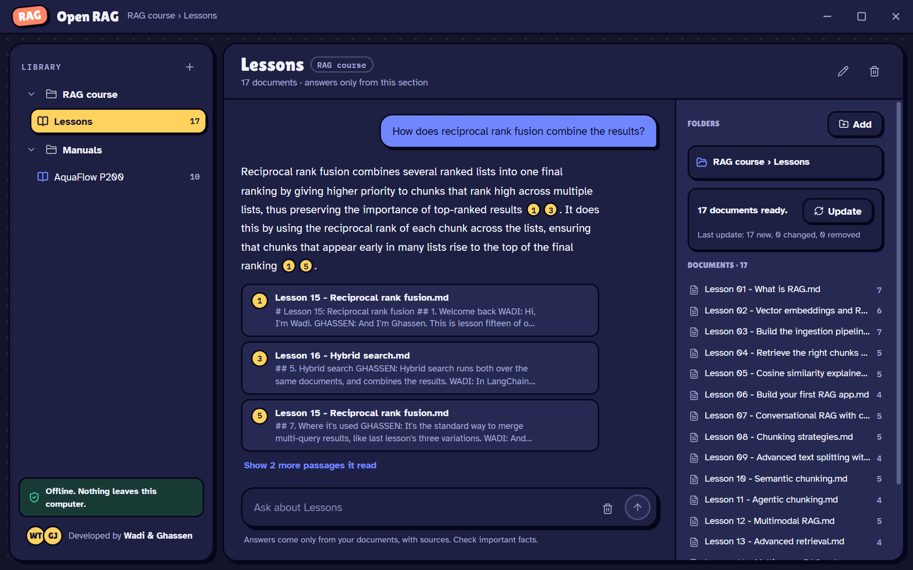
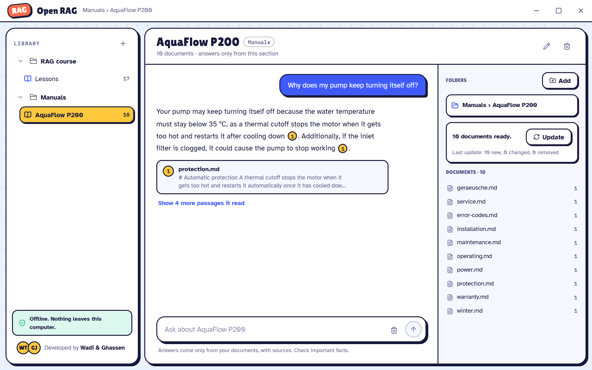
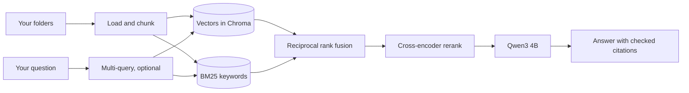
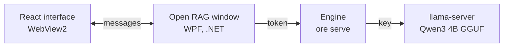
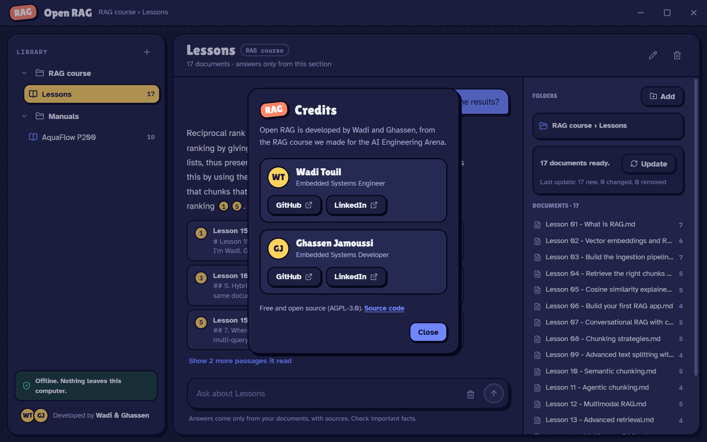

# Open RAG

**Ask questions about your own notes, PDFs and manuals, and get answers that cite the page. Everything runs on your computer.**

[](https://github.com/Carthavate/open-rag-engine/actions/workflows/ci.yml)
[](https://github.com/Carthavate/open-rag-engine/releases/latest)
[](LICENSE)



Open RAG is a free, open-source RAG engine with a desktop app for Windows. We built it from the RAG course we made for
the [AI Engineering Arena](https://carthavate.github.io/ai-engineering-arena/), using every technique the course covers:

- hybrid search
- reciprocal rank fusion
- multi-query
- reranking
- cited answers

It's for anyone who studies or teaches from a pile of documents: students, teachers and researchers.

## Download for Windows

1. From the [latest release](https://github.com/Carthavate/open-rag-engine/releases/latest), download all three files
   into the same folder: `OpenRag-Setup.exe`, `OpenRag-Setup-1.bin` and `OpenRag-Setup-2.bin`.
2. Run `OpenRag-Setup.exe`. The setup isn't code-signed yet, so Windows may say the publisher is unknown: choose
   **More info**, then **Run anyway**.

The setup brings its own Python, models and language model, so you don't need to install anything else. After
installing, it works without internet. It needs Windows 10 or 11 (64-bit), 8 GB of RAM and about 5 GB of disk.

## What it does



- **Your documents, organised.** Make categories (a subject, a research area) and sections (a course, a session, a
  reading list). Each section has its own folders.
- **Ask one section or a whole category.** Answers come only from the documents you chose.
- **Every answer shows its sources.** Each numbered citation comes with the passage it's based on. One click opens the
  document, or shows it in its folder. When the documents don't contain the answer, it says so instead of guessing.
- **Private by design.** The engine listens only on your own computer, behind a token. Nothing leaves the computer: no
  account, no telemetry, no cloud.
- **Multilingual.** The embedding, reranking and language models handle English, German, French, Arabic and more, so
  you can ask in the language of your documents.
- **Always current.** Click Update after you change a folder: new and changed files are indexed, and deleted ones
  drop out.

## How it works



The desktop app is a WPF window that shows a React interface in WebView2. The interface reaches the engine only through
the window, which adds the engine's token, so the page never holds it. The window starts two helper processes:

- the engine (`ore serve`, Python and LangChain)
- the language model (llama.cpp's `llama-server`)

Both run on 127.0.0.1 and close with the app.



The design decisions are recorded in [docs/adr](docs/adr), for example [ADR-0006](docs/adr/0006-python-and-langchain.md)
(Python and LangChain) and [ADR-0007](docs/adr/0007-desktop-app.md) (the desktop app).

## Run the engine from source

You need Python 3.12+, [uv](https://docs.astral.sh/uv/) and [Ollama](https://ollama.com/).

```bash
uv sync
ollama pull qwen3:4b-instruct-2507-q4_K_M
cd examples                      # a small pump manual, in English and German
uv run ore ingest docs
uv run ore ask "Why does my pump keep turning itself off?"
uv run ore search "error E1042" --trace
uv run ore eval eval.jsonl
uv run ore chat
```

The first run downloads the embedding and reranker models (about 1 GB). Everything then runs offline.

A real answer from the example:

```text
$ ore ask "Wie viel kostet der Drucksensor?"
Der Drucksensor PS-12 kostet 39 Euro [1].
  [1] service.md
```

To work on the desktop app, see [desktop/README.md](desktop/README.md). To build the installer, see
[installer/README.md](installer/README.md).

### What's inside

| Course technique | Where | Switch |
|---|---|---|
| Recursive, Markdown and semantic chunking | `chunking.py` | `[chunking] strategy` |
| Multilingual embeddings in Chroma | `store.py`, `factory.py` | `[embeddings] model` |
| Similarity, score threshold, MMR, metadata filters | `retrieval.py` | `[retrieval] search_type`, `--source` |
| BM25 keyword search + vectors, fused with reciprocal rank fusion | `retrieval.py`, `fusion.py` | `vector_weight`, `keyword_weight`, `rrf_k` |
| Multi-query (RAG-Fusion) | `fusion.py`, `pipeline.py` | `--multi-query` |
| Cross-encoder reranking | `rerank.py` | `[rerank]`, `--no-rerank` |
| Conversational follow-ups | `conversation.py` | `ore chat` |
| Cited answers that are checked, and abstention | `answer.py` | `[answer] min_rerank_score` |
| Retrieval evaluation (hit rate, MRR, recall) | `evaluation.py` | `ore eval` |

`ore serve` runs the same engine as a local API for the desktop app: categories, sections, background indexing and
streamed answers, reachable only from this computer.

Every setting lives in [`ore.toml`](examples/ore.toml). `--trace` shows what each stage returned and how long it took.

## Principles

- **Free and open.** AGPL-3.0, and no paid service required.
- **Explainable.** You can see what was retrieved, why it ranked where it did, and what the model was sent.
- **Measured.** Changes to retrieval or generation come with evaluation numbers.
- **Decisions are written down.** Architecture docs and decision records (ADRs) live in `docs/`.

## Roadmap

1. **Architecture:** requirements, design, first decision records. ✅
2. **Engine:** ingest, hybrid retrieval, reranking, answers with citations, and the evaluation harness. ✅
3. **Desktop app:** a Windows app with a self-contained installer. ✅ (0.1)
4. **Next:**
   - Check answers against their sources, sentence by sentence ([ADR-0005](docs/adr/0005-verified-citations.md)).
   - Read scanned pages and images (OCR).
   - Tune BM25 for German and other languages.
   - Retrieval over knowledge graphs.

## Contributing

We review each other's work through pull requests. See [CONTRIBUTING.md](CONTRIBUTING.md). Found a security issue? Please follow [SECURITY.md](SECURITY.md) instead of opening a public issue.

## License

[AGPL-3.0](LICENSE). You're free to use, modify and self-host it. If you run a modified version as a network service, you must share your changes under the same license.

The installer bundles models and libraries under their own licences, listed in
[installer/THIRD_PARTY_NOTICES.md](installer/THIRD_PARTY_NOTICES.md).

## Team



Open RAG is developed by:

- **Wadi Touil:** [GitHub](https://github.com/TWadi) · [LinkedIn](https://www.linkedin.com/in/wadi-touil-117472319/)
- **Ghassen Jamoussi:** [GitHub](https://github.com/GhassenJamoussi99) · [LinkedIn](https://www.linkedin.com/in/ghassen-jamoussi/)
