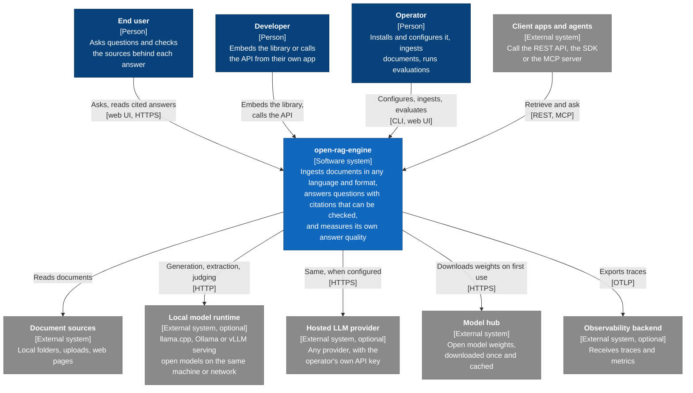

# 1. System context

> C4 level 1. Draft, 2026-10-17.

Embedding and reranking models run inside the system by default, on the CPU. Only the larger generation models live in a separate runtime or behind a hosted API.

## People

| Person | Goal | Main touchpoints |
|--------|------|------------------|
| End user | A correct answer, quickly, with the exact passage, page, table or figure it came from | Web UI |
| Developer | Retrieval or question answering inside their own application, behind a stable API with predictable behaviour | Library, REST API, MCP |
| Operator | Run it on their own hardware, pick the models, keep the index current, and prove its quality with numbers | CLI, web UI, configuration file |

In v1 these are often the same person on the same laptop. Separate users and roles come with the multi-user extension (driver D-09).

## External systems

| System | Why we depend on it | Required? | What crosses the boundary |
|--------|--------------------|-----------|---------------------------|
| Document sources | The content to ingest | Yes | Documents, inbound |
| Local model runtime | Runs larger LLMs outside our process, on CPU or GPU | One LLM backend, local or hosted, is needed to generate answers | Prompts containing retrieved passages; they stay on the machine or the local network |
| Hosted LLM provider | Better or faster generation when the operator brings a key | No | Prompts containing retrieved passages leave the machine |
| Model hub | Open weights for embedders, rerankers, parsers and LLMs | Only for the first download. Can be pre-seeded for offline installs | Model files, inbound. Nothing about the user's data goes out |
| Observability backend | Long-term traces and dashboards | No. Traces are also kept locally | Trace data, which can include query text and passages |
| Client apps and agents | Use the engine as a retrieval or Q&A service | No | Queries inbound; answers and passages outbound |

Without any LLM backend the engine still ingests, indexes and retrieves. It cannot generate answers, build an LLM-extracted graph or compute LLM-judged metrics, and it says so instead of failing.

## Trust boundaries and privacy

- **Documents are untrusted input.** Files can be malformed or malicious, and their text can carry prompt-injection attempts. Parsers run in the worker under resource limits, and retrieved text reaches the model as quoted data, never as instructions.
- **Model output is untrusted.** Citations are checked against the passages that were actually sent to the model before they are shown.
- **Nothing leaves the machine by default.** With the laptop profile and local models, no document text, query or telemetry leaves the device. The engine does not phone home.
- **Egress is explicit.** When a hosted LLM or an external trace backend is configured, the UI and every trace say so, so users can see which passages left the machine and where they went.
- **Credentials stay out of configuration and traces.** API keys come from environment variables or a secret store.
