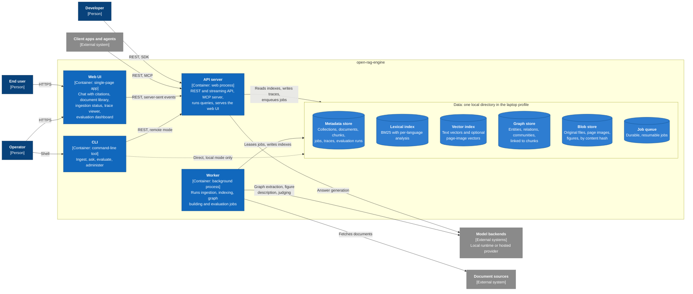

# 2. Containers

> C4 level 2. Draft, 2026-10-17. Technologies stay open until the ADRs; the table at the end says which decision fills each gap.

The API server, the worker and the CLI are three entry points over **one core library**, which developers can also import into their own process. C4 doesn't draw libraries as containers; the [component view](03-components.md) shows what is inside it.

## Responsibilities

| Container | Responsibilities | State | Scales by |
|-----------|------------------|-------|-----------|
| Web UI | Streaming chat with clickable citations that open the source page with the cited region highlighted. Document library and upload, job progress, the trace viewer ("why this answer?"), evaluation runs and comparisons. | None outside the browser | Static files |
| API server | Authentication and request context. Collection and document management. Runs the query pipeline and streams answers. A retrieval-only endpoint. MCP tools. Stores traces and feedback. Serves the UI. | Stateless; all state lives in the data stores | More processes behind a load balancer (server profile) |
| Worker | Runs jobs: parse, chunk, embed, index, extract the graph, summarise communities, run evaluations, build index generations. The only writer of the indexes. | Stateless; progress is checkpointed in the job queue | More worker processes. Jobs are per document, so they parallelise |
| CLI | Scripting and administration: ingest folders, ask, run evaluations in CI, inspect traces, manage generations. | None | n/a |
| Metadata store | System of record: collections and their configuration, documents and versions, elements and chunks, index generations, jobs, traces, feedback, evaluation datasets and runs. | Durable | A database server in the server profile |
| Lexical index | BM25 search over chunk text, analysed per language. | Derived, rebuildable | Per collection and generation |
| Vector index | Nearest-neighbour search over chunk vectors and optional page-image vectors, with filtering inside the search. | Derived, rebuildable | Per collection and generation |
| Graph store | Entities, relations and communities, each linked to the chunks that support it. | Derived, rebuildable (expensively) | Per collection |
| Blob store | Content-addressed originals and derived binaries such as page renders and figure crops. | Durable | Object storage in the server profile |
| Job queue | Durable job records with leases, retries, idempotency keys and progress. | Durable | A queue service in the server profile |

## Runtime rules

- **One writer per index.** Only the worker writes to the lexical, vector and graph stores. The API server reads them and writes only the metadata it owns: traces, feedback, uploads and job requests. Embedded indexes stay safe without distributed locks.
- **Indexes are derived data.** The metadata store and the blob store are the system of record, and every index can be rebuilt from them. Backups stay small and model changes stay safe (see [index generations](06-domain-model.md#index-generations)).
- **A query reads one index generation.** It pins the collection's active generation when it starts, so a rebuild running in the background never mixes results from two embedding models.
- **The CLI opens the data directory only when no server owns it.** Otherwise it talks to the server over REST. A lock file in the data directory enforces this.
- **Jobs are per document and idempotent.** Re-running a job with the same content hash and configuration does nothing, so a crash costs at most the document in flight.

## Two profiles, one design

| | Laptop profile (default) | Server profile |
|---|---|---|
| Processes | One. The API server runs the worker as a background task, and one command starts everything. | API servers and workers run as separate processes and scale independently. |
| Data | One local directory with embedded stores | Database servers and object storage |
| Models | Embedders and rerankers in-process on the CPU; the LLM through a local runtime or a hosted key | The same ports, bound to model servers on GPU machines |
| Access | A local API key; listens on localhost only by default | API keys in v1; an identity provider with the multi-user extension (D-09) |

The containers and their contracts are identical in both profiles. Only the adapters bound to the ports, and the process layout, change.

## Open technology choices

| Container | Decided in |
|-----------|------------|
| Web UI | ADR: language and framework |
| API server, worker, CLI | ADR: language and framework; ADR: API style |
| Metadata store, lexical index, vector index | ADR: storage |
| Graph store | ADR: GraphRAG method and graph store |
| Blob store, job queue | ADR: storage; ADR: deployment |
| Model backends | ADR: embedding and reranker models; ADR: LLM backends |
