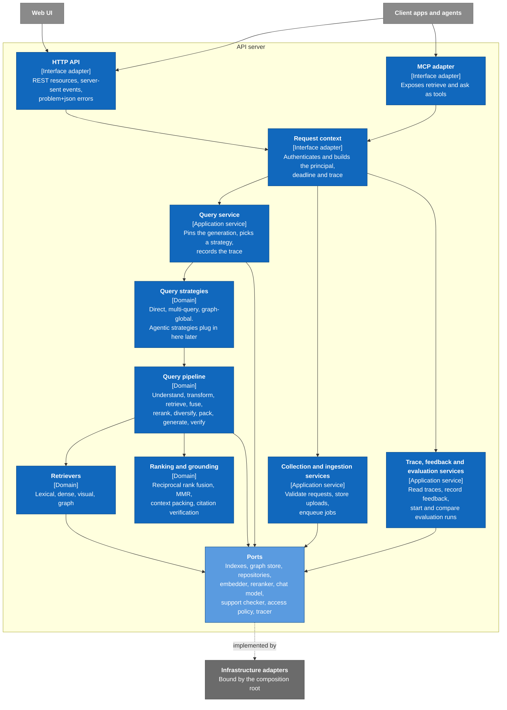
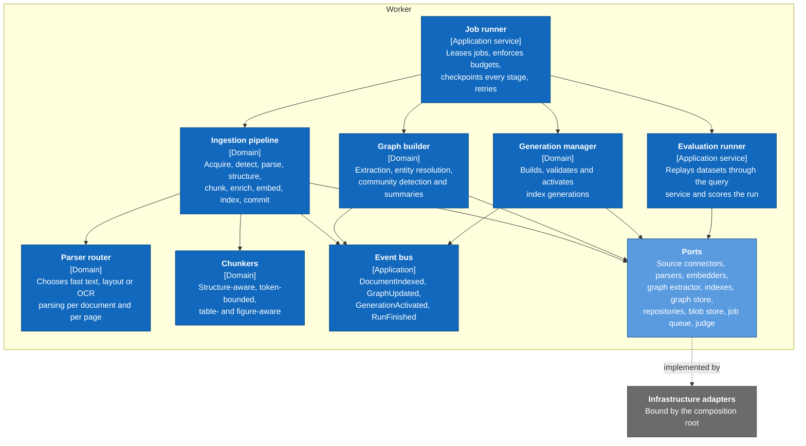

# 3. Components

> C4 level 3 for the two containers that hold the logic: the API server, which runs the query path, and the worker, which runs the ingestion path. Both are assembled from the same core library; each diagram shows the parts of it that container exercises. Draft, 2026-10-17.

## 3.1 API server

## 3.2 Worker

The evaluation runner calls the same query service the API server uses (principle 5). Evaluation never gets its own copy of the pipeline.

## Component responsibilities

| Component | Layer | Responsibility | Main ports used |
|-----------|-------|----------------|-----------------|
| HTTP API, MCP adapter | Interfaces | Map requests to service calls and results to responses. No business logic. | None directly |
| Request context | Interfaces | Authenticate, build the principal, set the deadline, open the root trace span. | Access policy, tracer |
| Query service | Application | Pin the active generation, apply the access filter, run the chosen strategy within its budget, persist the trace. | Repositories, access policy, tracer |
| Collection and ingestion services | Application | Validate collection configuration against adapter capabilities, store uploads, create jobs. | Repositories, blob store, job queue |
| Trace, feedback and evaluation services | Application | Read traces, record feedback, start evaluation runs, compare runs. | Repositories, job queue |
| Query strategies | Domain | Decide which retrievers to use and how many pipeline passes to run. | Chat model (for routing and rewriting) |
| Query pipeline | Domain | Run the fixed sequence of slots and emit a span per slot. | All query-side ports |
| Retrievers | Domain | One per index type. Turn a query into ranked candidates with provenance. | Lexical and vector indexes, graph store, embedder, text analyser |
| Ranking and grounding | Domain | Fusion, diversification, context packing within the token budget, citation verification. Pure functions. | Reranker, support checker |
| Job runner | Application | Lease jobs, run them stage by stage, checkpoint, retry, report progress. | Job queue, repositories |
| Ingestion pipeline | Domain | Turn a raw document into indexed chunks with provenance. | Source connectors, parsers, language detector, embedders, indexes, blob store |
| Parser router | Domain | Pick the cheapest parser that can handle each document and page: plain text first, layout analysis or OCR only where needed. | Document parsers (via their capabilities) |
| Chunkers | Domain | Split the document tree along its structure, within token limits, keeping tables and figures whole where possible. | None (pure) |
| Graph builder | Domain | Extract entities and relations, resolve duplicates, detect communities, summarise them, and mark stale summaries after updates. | Graph extractor, graph store, chat model |
| Generation manager | Domain | Build a new index generation when the configuration changes, reuse unchanged builds, validate, activate, roll back. | Indexes, repositories |
| Evaluation runner | Application | Replay a dataset through the query service and compute retrieval, answer and performance metrics. | Judge, support checker, repositories |
| Event bus | Application | Deliver domain events to subscribers inside the process (UI progress, cache invalidation, graph refresh). | None |

## Extension points

| Extension | Seam | What changes |
|-----------|------|--------------|
| Agentic RAG | Query strategy | A new strategy that plans, calls retrieval repeatedly as a tool, and stops on a step, token or time budget. The slots it reuses don't change. |
| Multi-user and permissions | Request context and access-policy port | A real identity provider in the request context, and a policy that turns the principal into an index filter. Every record already carries tenant and access fields. |
| New document formats | Document parser port and parser router | A new adapter and a routing rule. |
| New sources (object storage, Git, wikis) | Source connector port | A new adapter. |
| New stores or models | Storage and model ports | A new adapter, selected in configuration and validated by capability checks. |
| Learned sparse or late-interaction retrieval | Retriever slot | A new retriever. Fusion picks it up without changes. |
