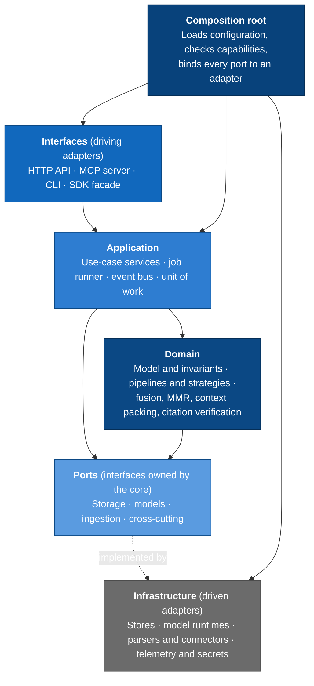
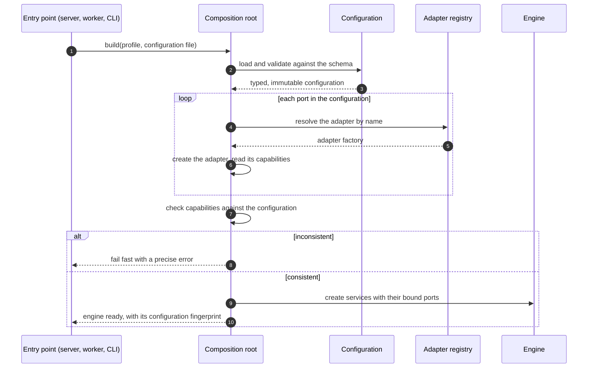

# 4. Layers and dependency rules

> Draft, 2026-10-17.

The core is organised as ports and adapters (hexagonal architecture): the domain and application logic sit in the middle, define the interfaces they need, and never depend on the technology behind them.

Solid arrows are allowed dependencies. The dotted arrow reads "implemented by": the code dependency runs from the adapters up to the port definitions, never the other way round.

## The layers

| Layer | Contains | May depend on | Must not depend on |
|-------|----------|---------------|--------------------|
| Interfaces | HTTP routes, streaming, MCP tools, CLI commands, the SDK facade, request and response mapping | Application services and their data types | Domain internals, ports, adapters |
| Application | One service per use case, transactions (unit of work), job orchestration, budgets, events, the request context | Domain, ports | Interfaces, adapters, any I/O library |
| Domain | Entities, value objects and invariants; pipelines, strategies and stage logic; ranking and grounding algorithms; the configuration schema | Ports (as interfaces), the standard library, pure numeric libraries | Everything else |
| Ports | Interfaces and the data types they exchange | Domain types | Everything else |
| Infrastructure | One adapter per technology: stores, model runtimes, parsers, connectors, telemetry, secrets | Ports, domain types, its own third-party SDK | Application, interfaces, other adapters |
| Composition root | Configuration loading, capability checks, the adapter registry, plugin discovery | Everything | Nothing depends on it |

## Rules

| ID | Rule | Why |
|----|------|-----|
| R-01 | The domain never performs I/O: no database drivers, HTTP clients, model SDKs or file access. | Domain logic is unit-tested with in-memory fakes, fast and offline. |
| R-02 | Only adapters import third-party SDKs for storage, models, parsing and telemetry. | Swapping a vendor touches one module. |
| R-03 | Adapters don't import each other. | No hidden coupling between technologies. Shared logic belongs in the domain. |
| R-04 | Interfaces only call application services. A route handler never reaches into a repository or a model port. | The HTTP API, MCP, CLI and SDK behave identically because they share one path. |
| R-05 | Only the composition root names concrete adapters. Everything else receives ports through its constructor. | Configuration, not code, decides the wiring. |
| R-06 | Ports exchange domain types, never vendor types. A vector index returns `Hit` objects, not a database client's rows. | Vendor types would leak the vendor into the core. |
| R-07 | Every port has a fake adapter for tests and a shared contract test suite. Every real adapter must pass that suite. | Adapters are interchangeable in fact, not just in theory. |

## Enforcement

- **Import rules R-01 to R-05 are checked in CI** by an import-contract linter ([import-linter](https://github.com/seddonym/import-linter) if the language ADR confirms Python). A violation fails the build like a failing test.
- **Port contract suites (R-07) run against every adapter in CI.** An adapter that fails cannot be registered.
- **New ports and new layer dependencies need review.** A pull request that adds either updates this page or comes with an ADR.

## Packaging

- The domain, the application layer, the ports and the light default adapters ship as one installable package, small enough for a laptop.
- Heavy adapters (layout parsing and OCR, GPU runtimes, database servers) are optional extras, so the base install never pulls in a GPU stack.
- Third-party adapters register through a plugin entry point and must pass the same contract suites.

## Composition at startup

Examples of startup checks:

- The vector index's dimensions match the embedder's.
- The embedder and the reranker cover the collection's configured languages; if not, the engine warns and names the gap.
- The chat model's context window fits the context budget plus the answer budget.
- Every index adapter supports the filter operators the access policy needs.
- Optional stages whose adapters are missing are disabled explicitly and reported, never skipped silently.
