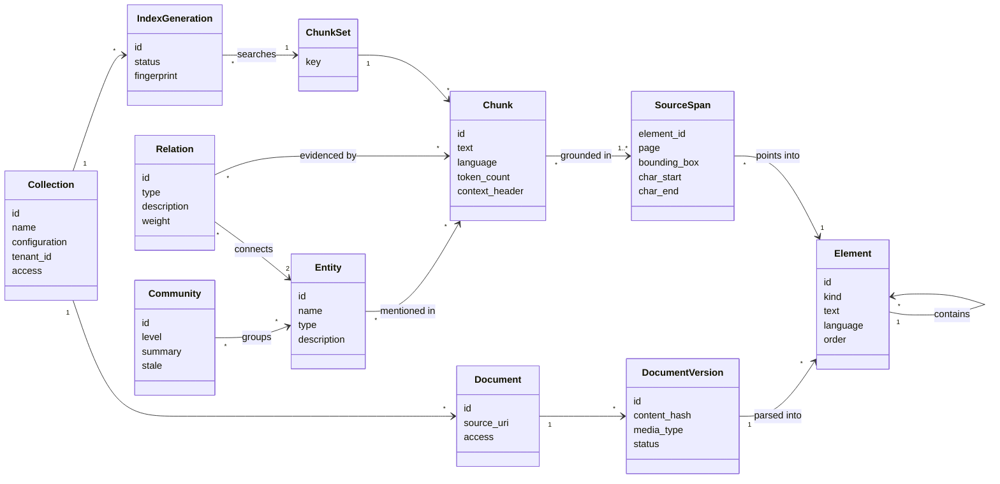
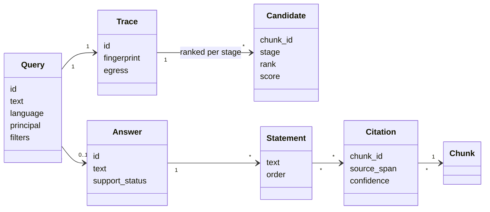
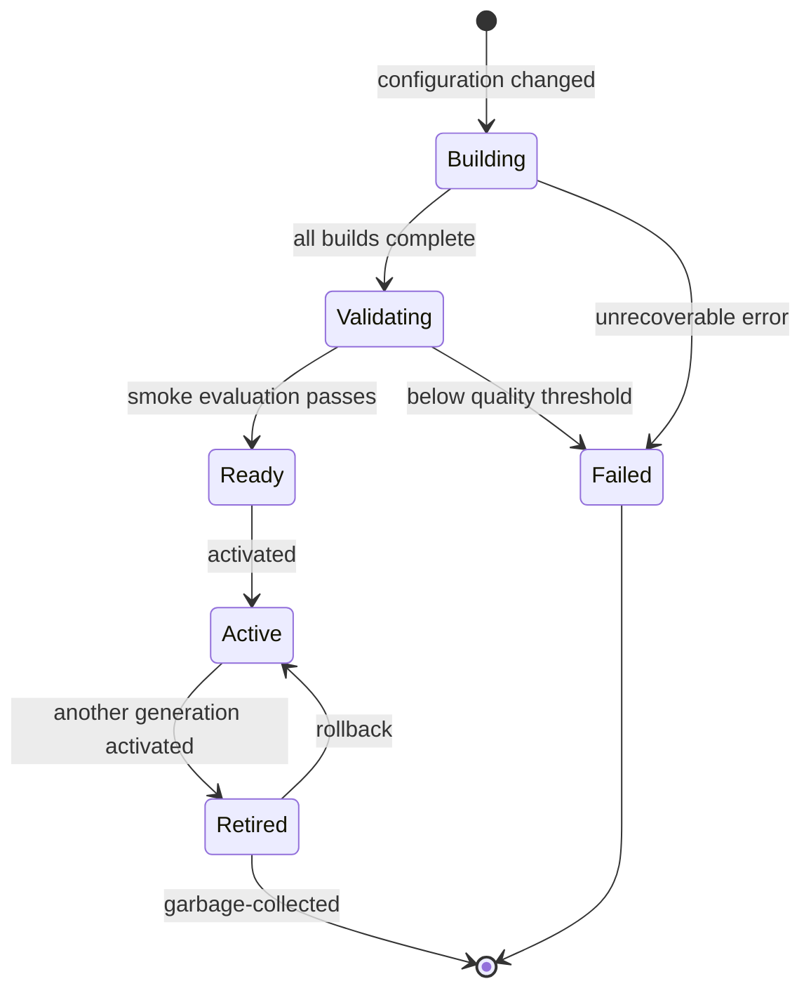
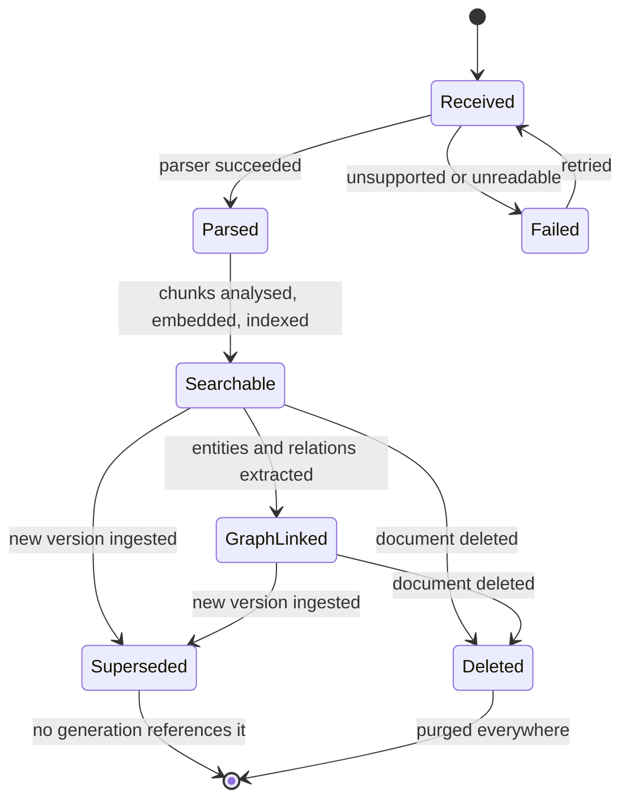

# 6. Domain model

> Draft, 2026-10-17.

## Documents, chunks and the graph

**Elements** form the document tree produced by parsing. Kinds: `section`, `heading`, `paragraph`, `list`, `table`, `figure`, `caption`, `code`, `formula`, `page`. A `table` keeps its structure (rows, columns, header cells) as well as a text rendering. A `figure` keeps the image (by blob hash), its caption and, optionally, a generated description. Every element knows its page and bounding box, so a citation can highlight the exact region in the UI.

**Chunks** are the unit of retrieval. A chunk follows the document structure, stays within a token limit, and carries a short context header (document title and section path) that is indexed with it.

## Answers and citations

An answer's `support_status` is `supported`, `partially_supported` or `abstained`. The trace records the ranked candidates after every stage (per retriever, fused, reranked, diversified, packed), which powers the "why this answer?" view and makes evaluation runs comparable stage by stage.

## Invariants

| ID | Invariant |
|----|-----------|
| I-01 | **Every chunk is grounded.** It has at least one source span, and every span resolves to an element of an immutable document version. |
| I-02 | **Document versions are immutable.** Changed content creates a new version. The old version stays until no index generation references it, and is then garbage-collected. |
| I-03 | **A query reads exactly one index generation per collection**, pinned when the query starts. |
| I-04 | **Answers only cite what the model saw.** A citation must reference a chunk in the packed context recorded in that answer's trace. Verification removes anything else. |
| I-05 | **Graph results resolve to chunks.** Entities, relations and communities link to the chunks that support them. Community summaries are generated text, so an answer never cites a summary; it cites the chunks behind it. |
| I-06 | **Every record carries tenant and access fields.** In v1 they hold defaults (one tenant, open access), so turning on permissions later needs no data migration. |
| I-07 | **IDs come from content where possible.** A chunk's ID is a hash of its document version, its source spans and the chunker configuration, so re-ingesting the same content changes nothing. |

## Index generations

A generation is everything needed to search a collection under one configuration. It is made of four builds, each keyed by its inputs and its own configuration:

| Build | Inputs | Rebuilt when |
|-------|--------|--------------|
| Chunk set | Document versions, parser and chunker configuration | Parsing or chunking changes |
| Lexical build | Chunk set, analyser configuration | The chunk set or the analysis changes |
| Vector build | Chunk set, embedder identity | The chunk set or the embedding model changes |
| Graph build | Chunk set, extractor identity and configuration | The chunk set or the extraction changes |

Unchanged builds are reused. Switching the embedding model re-embeds the chunks but keeps the chunk set and the expensive graph. Graph extraction results are also cached per chunk content hash, so a chunking change only re-extracts chunks whose text actually changed. The generation's fingerprint combines its build keys and appears in every trace and evaluation run.

Adding or deleting documents updates the active generation incrementally. A new generation is built only when the configuration changes.

The smoke evaluation is optional: when the collection has an evaluation dataset, a new generation must not score worse than the active one beyond a configured tolerance before it can be activated.

## Document lifecycle

A document becomes searchable through the lexical and vector indexes before graph extraction finishes. On a CPU laptop, graph extraction is the slowest stage, so it runs as background enrichment and never blocks basic search.

## Deletion

Deleting a document takes effect in two steps:

1. **Immediately:** the document is tombstoned, and the tombstone is part of every search filter, so it disappears from results at once.
2. **In the background:** its chunks are removed from the lexical and vector builds and its mentions from the graph. Entities and relations left without evidence are removed, and the affected communities are marked stale and re-summarised. Blobs are deleted once no other version references them, and traces that quoted the document have those passages redacted.
