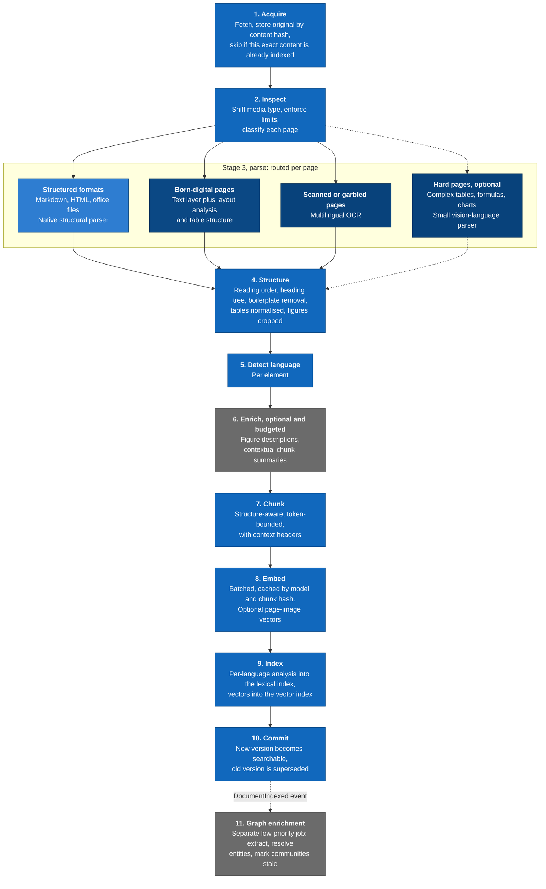
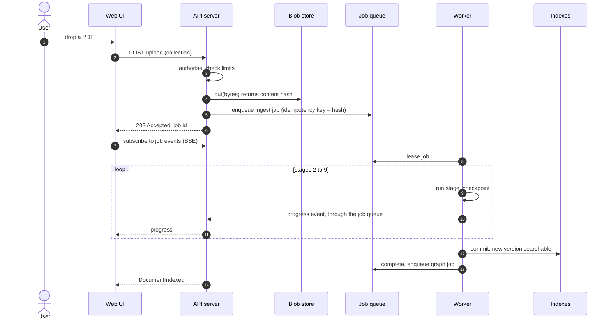

# 7. Ingestion pipeline

> Draft, 2026-10-17. Tools named here are examples from the [research](../research/README.md); the defaults are fixed in the parsing and model ADRs.

Ingestion turns a raw file into searchable chunks with provenance. It runs in the worker as a job per document, and it is built around one constraint: **on a CPU laptop, the expensive work must be proportional to how hard each page actually is.**

## Stages

Grey stages are optional and budgeted. Dotted arrows are paths that only run when enabled.

| # | Stage | What it does | Output | Notes |
|---|-------|--------------|--------|-------|
| 1 | Acquire | Fetches through a source connector and stores the original in the blob store. If the document already has a version with the same content hash, the job ends here. | Document version in state `Received` | Content addressing makes re-ingestion a no-op |
| 2 | Inspect | Detects the media type from the bytes, not the file extension. Enforces size, page and decompression limits. Classifies each PDF page as born-digital, scanned or hard, using text-layer quality and layout signals. | Per-page routing plan | The plan is recorded in the trace, so routing decisions can be audited and tuned |
| 3 | Parse | The parser router sends each page to the cheapest parser that can handle it. Hard pages go to a vision-language parser only when that is enabled and within budget; otherwise they fall back to OCR and are flagged. | Elements with page and bounding box | One document can mix parsers page by page |
| 4 | Structure | Merges parser output into one document tree: reading order, heading hierarchy, removal of headers and footers that repeat on every page, Unicode normalisation, de-hyphenation. Tables get explicit header cells plus a text rendering. Figures are cropped into the blob store and linked to their captions. | Document tree | |
| 5 | Detect language | Detects the language of every element, so mixed-language documents are analysed correctly. | Language per element | |
| 6 | Enrich | Optional. Describes figures with a vision-language model so they become searchable as text. Optionally writes a short contextual summary for each chunk. Both cost model calls and are capped per collection. | Descriptions attached to elements | Off by default on the laptop profile |
| 7 | Chunk | Walks the tree and packs sibling elements of one section up to a token limit measured with the embedder's own tokenizer. Tables stay whole when they fit; larger tables are split by row groups with the header row repeated. Figures become their own chunk (caption plus description). Code blocks are never split. Long paragraphs are split on sentence boundaries. Every chunk gets a context header (document title and section path) and knows its parent section, so the query side can expand to it. | Chunks with source spans | Chunk IDs come from content, so unchanged chunks keep their ID |
| 8 | Embed | Embeds chunk text in batches, skipping chunks whose vector is already cached for this model. Optionally embeds page images for visual retrieval. | Vectors | |
| 9 | Index | Analyses each chunk with the analyser for its language and writes it to the lexical index, then writes vectors to the vector index. Filterable metadata goes with both: tenant, access, document, language, element kinds, page, dates. | Entries in the active generation | Only the worker writes indexes |
| 10 | Commit | Makes the new version searchable, then supersedes the previous version and removes its chunks. The new version is indexed before the old one disappears, so the document never drops out of search during an update. | Version in state `Searchable`, `DocumentIndexed` event | |
| 11 | Graph enrichment | A separate, low-priority job. See below. | Version in state `GraphLinked` | Never blocks search |

## Graph enrichment

The [graph research](../research/graphrag-family.md) shows that LLM-built graphs collapse with small models and cost hours per book on a CPU, while graphs built from named entities and co-occurrence, with no LLM at all, now match or beat them on multi-hop benchmarks. Extraction is therefore tiered:

| Tier | Method | Cost on a laptop CPU | Default |
|------|--------|----------------------|---------|
| 0 | Off | None | |
| 1 | Multilingual named-entity recognition and co-occurrence: a graph of chunks, sentences and entities, with no LLM | Minutes per book | **Yes, on the laptop profile** |
| 2 | LLM extraction of typed relations and descriptions, with constrained output, 300–600-token windows, per-window caps, timeouts, and fallback to tier 1 when the output can't be parsed | Hours per book on CPU; practical with a GPU or a hosted model | On the GPU and server profiles, if spike S-3 confirms the value |

- **Cached and incremental.** Extraction results are cached by chunk content hash, extractor identity and prompt version, so re-chunking only re-extracts changed text, and deletions remove exactly the evidence they contributed. New documents add to the existing graph.
- **Entity resolution in cheap steps:** normalised names first, then embedding and fuzzy-string similarity, then an optional LLM verdict for ambiguous pairs.
- **Communities are re-clustered locally.** Only the part of the graph that changed is re-clustered, and the refresh is debounced so a bulk import triggers one refresh, not thousands.
- **Summaries are lazy.** Community summaries are written the first time a query needs them, then cached until the community changes. Operators with spare capacity can pre-summarise.
- **Budgeted.** Extraction has a token and time budget per collection, with an estimate shown before it starts. When the budget runs out, the remaining chunks wait for the next idle period; search keeps working with the graph built so far.

## Resource scheduling on a laptop

Stages are tagged with a resource class, and the worker limits concurrency per class:

| Class | Stages | Laptop profile | Server profile |
|-------|--------|----------------|----------------|
| Light | Acquire, inspect, structure, language, chunk, index, commit | Several in parallel | Many in parallel |
| Heavy CPU | Layout analysis, OCR, embedding | One at a time | One per core group or GPU |
| Model | Vision-language parsing, figure description, graph extraction, community summaries | One at a time, and only when no heavy CPU stage is running | One per model server slot |

Layout parsing alone can peak at several gigabytes of memory, so on a 16 GB machine it must not run alongside a loaded LLM. Heavy stages run in a child process with memory and time limits, which also isolates the engine from crashing or malicious parsers. Interactive uploads take priority over bulk imports, and graph jobs run last.

## Failure handling

- **Checkpoint per stage.** A restarted job resumes from the last completed stage.
- **Partial success is reported, never hidden.** If 3 pages of a 200-page PDF fail to parse, the other 197 are indexed and the document is flagged with the page numbers that failed.
- **Retries** use exponential backoff for retryable errors. After a configured number of attempts the document moves to `Failed` with the reason, and the UI shows it.
- **Limits protect the machine:** maximum file size, page count, decompression ratio and parse time per page. No macros or embedded scripts are ever executed.

## Upload sequence

