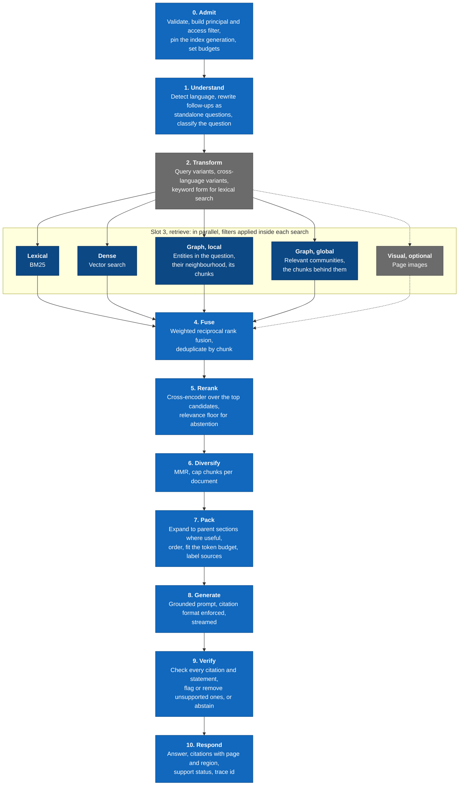
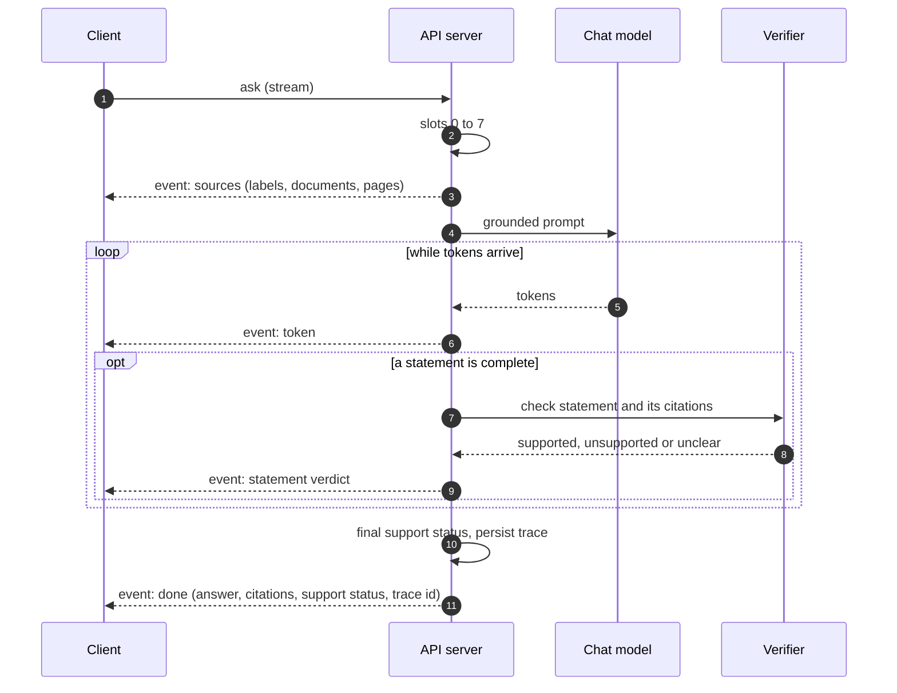

# 8. Query pipeline

> Draft, 2026-10-17. Numbers such as candidate counts are starting points to be tuned with the evaluation loop, not requirements.

The query pipeline is a fixed sequence of slots (principle 2). A **query strategy** decides which slots run, with which retrievers, and how many times. Every slot emits a trace span with the ranked candidates it produced.

## Slots

| # | Slot | What it does | Default | Why it is there |
|---|------|--------------|---------|-----------------|
| 0 | Admit | Validates the request, asks the access policy for the principal's filter, pins the collection's active generation, and sets the deadline and token budgets. | Always | Permissions, consistency (invariant I-03) and budgets are decided once, up front |
| 1 | Understand | Detects the question's language. If there is conversation history, rewrites the question as a standalone one. Classifies it as a lookup, a multi-hop or comparison question, a global question ("what are the main themes?"), or out of scope. | Classification by a small model or rules; rewriting only with history | The class drives the strategy |
| 2 | Transform | Generates query variants (multi-query). Adds translations into the collection's main languages for the lexical retriever, because BM25 cannot match across languages while multilingual dense retrieval can. Extracts a keyword form. | Variants off on the laptop profile, cross-language variants on when the question's language differs from the corpus | Recall, especially across languages |
| 3 | Retrieve | Runs the selected retrievers in parallel, each over every query variant. Every retriever applies the access filter inside its search and returns candidates with scores and provenance. | Lexical and dense always; graph by question class; visual if enabled | Different retrievers fail on different questions |
| 4 | Fuse | Weighted reciprocal rank fusion over all retriever and variant lists, deduplicated by chunk. Per-retriever ranks are kept for the trace. | k = 60, equal weights | Rank-based fusion needs no score calibration between retrievers |
| 5 | Rerank | A cross-encoder scores the top fused candidates against the question. If even the best score is below the relevance floor, the pipeline signals "insufficient evidence". | Top 30 to 50 | Typically the biggest single gain in answer quality per unit of compute |
| 6 | Diversify | Maximal marginal relevance removes near-duplicates, and a per-document cap stops one long document from crowding out the others. | λ = 0.7 | Context space is scarce on small models |
| 7 | Pack | Expands chunks to their parent section where that adds needed context (small-to-big), orders passages so the most relevant sit at the start and end, fits the context budget (context window minus prompt minus answer budget), and labels each passage `[S1]`, `[S2]` and so on. Tables are rendered as Markdown; figures by caption and description. | | Small models lose information in the middle of long contexts |
| 8 | Generate | A versioned prompt template: answer only from the sources, cite a source label after every statement, answer in the question's language, and say so when the sources don't contain the answer. Passages are inserted as delimited, quoted data, never as instructions. When the backend supports constrained output, the citation format is enforced by a schema or grammar. | Streaming | Grounding and prompt-injection resistance |
| 9 | Verify | Splits the answer into statements. Checks that every cited label exists in the packed context (invariant I-04). Asks the support checker whether the cited passage supports the statement. Unsupported statements are flagged or removed according to policy; uncited statements get a post-hoc attribution attempt. Computes the support status, and abstains if nothing is supported. | NLI model on CPU; LLM checker optional | Citations users can trust |
| 10 | Respond | Returns the answer, its statements and citations (document, page, bounding box), the support status, timings, the trace id, and whether anything left the machine. | | |

## Strategies

| Strategy | When the router picks it | Slots and retrievers |
|----------|--------------------------|----------------------|
| `direct` | Lookup questions | Lexical and dense retrieval, single query, all later slots |
| `multi_query` | Multi-hop or comparison questions, or low retrieval confidence on a first pass | Adds query variants in slot 2 and graph-local retrieval |
| `graph_global` | Global or summary questions | Graph-global retrieval over community summaries; packs the chunks behind the best communities, with summaries only as orientation for the model, never as citable sources |
| `retrieve_only` | The `retrieve` operation, or no LLM backend configured | Slots 0 to 7; returns passages instead of an answer |
| `auto` (default) | | The router chooses from the question class |
| *agentic (later)* | Questions needing several dependent lookups | A planner loops over slots 2 to 7 as a tool, within a step, token and time budget, then runs 8 to 10 once |

## Budgets and graceful degradation

Every query has a deadline and a token budget. When the budget is tight, for example a CPU laptop with a slow model, the strategy degrades in a fixed order, and each step is recorded in the trace:

1. Drop query variants (slot 2).
2. Rerank fewer candidates.
3. Replace an LLM support checker with the NLI checker.
4. Shrink the packed context.
5. Return the retrieved passages without a generated answer (`retrieve_only`), clearly labelled as such.

The engine never silently returns a worse answer. The response says which steps were skipped.

## Streaming with verification

Verification needs complete statements, but users want tokens immediately. The answer therefore streams in two channels:

The UI shows citations as provisional until their verdict arrives, then marks them verified, or strikes the statement through with a note. Clients that don't stream get only the final, verified answer.

## What the trace records

For every query: the classification and chosen strategy, every query variant, the ranked candidate list after each retriever, after fusion, after reranking and after diversification (chunk IDs, scores, ranks), the packed context and its token count, the prompt template version, model identities, the raw and verified answer, per-statement verdicts, timings per slot, skipped steps, and any data egress. The trace is what the "why this answer?" view shows, and what the evaluation loop uses to find which stage lost the right passage.
