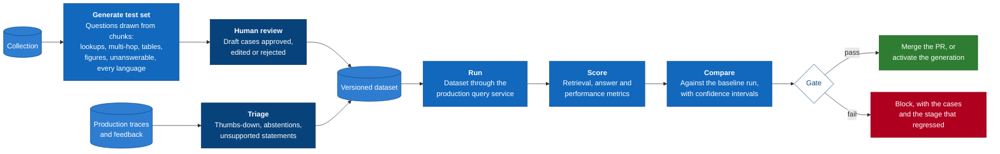

# 9. Evaluation loop

> Draft, 2026-10-17. Specific frameworks and public benchmarks are chosen with the research results; this page fixes the structure.

Evaluation is a product feature, not a script in a side folder. It answers three questions on every change: **did retrieval find the right passages, did the answer stay faithful to them, and what did it cost in time and tokens?** It uses the production query service (principle 5), so a passing evaluation measures the code that users actually run.

## The loop

## Datasets

| Source | How cases are made | What they test |
|--------|-------------------|----------------|
| Synthetic, from the collection | A model samples chunks across documents, element kinds (text, tables, figures) and languages, and writes questions with the expected source chunks and a reference answer. It also writes multi-hop questions that need two chunks, and questions the corpus cannot answer. Every case stays a draft until a person approves it. | Retrieval and answers on the user's own data |
| Hand-written | Operators add cases from real questions, with expected sources. | What actually matters to the users |
| From production | Traces with negative feedback, abstentions or unsupported statements go to a triage queue; accepted ones become cases. | Failures users actually hit |
| Public benchmarks | Adapters load standard retrieval, multilingual, multi-hop and visual-document benchmarks into the same format. | Comparability with published results, for the README and for credibility |

Datasets are versioned. A case records its question, language, expected source chunks (by content hash, so they survive re-chunking where the text is unchanged), an optional reference answer, and whether it should be answerable.

## Metrics

| Group | Metric | How it is computed |
|-------|--------|--------------------|
| Retrieval | Recall@k, MRR, nDCG@k | Against expected source chunks. Computed **per stage**: after each retriever, after fusion, after reranking, after diversification and in the packed context, using the trace |
| Answer | Faithfulness | Share of statements supported by their cited passages (support checker) |
| | Citation precision and recall | Precision: share of citations that support their statement. Recall: share of statements that carry a supporting citation |
| | Correctness | Against the reference answer, when there is one: LLM judge, with token-overlap and semantic-similarity scores reported alongside |
| | Abstention accuracy | Abstains on unanswerable cases, answers the answerable ones |
| | Language match | The answer is in the question's language |
| Performance | Latency per slot (p50, p95), time to first token, tokens in and out, peak memory, cost for hosted models | From the trace |
| Ingestion | Parse coverage; table-structure fidelity on a small labelled set | From ingestion reports |

**Per-stage retrieval metrics are the key diagnostic.** They show *where* a right passage was lost: found by BM25 at rank 3, then pushed out by fusion, or dropped by the reranker. That turns "the answer was wrong" into a specific fix.

## Judges

- **Deterministic metrics first.** Anything that can be computed without a model (retrieval metrics, citation existence, language match, latency) is.
- **Model judges are calibrated.** The judge and support checker are scored against a small human-labelled set, and their agreement is reported with every run.
- **The judge is never the generator.** Using the same model to answer and to grade inflates scores, so the configuration rejects it.
- **Local by default, stronger on request.** A small local judge keeps evaluation free; a hosted judge with the operator's own key is an option for release benchmarks. The judge's identity is part of the run fingerprint.

## Runs and reproducibility

A run is a dataset version evaluated under one **run fingerprint**: the engine configuration hash, the index generation fingerprint, every model identity, the prompt template versions, the judge identity and the random seed. Two runs with the same fingerprint must give the same retrieval results, and answer metrics within sampling noise. Caches for embeddings and model outputs make re-runs cheap.

Comparisons are paired, case by case, with bootstrap confidence intervals. A gate fails only when a drop is both statistically significant and larger than the configured tolerance, so noise does not block pull requests.

## Where the loop runs

| Trigger | Dataset | Models | Gate |
|---------|---------|--------|------|
| Every pull request that touches retrieval, generation, parsing or prompts | Small smoke set: tens of cases, multilingual, including tables, figures and unanswerable questions | Small local models, so CI stays free and fast | Blocks the merge on a significant regression |
| Nightly on `main` | Full project datasets and public benchmark subsets | Default laptop stack | Opens an issue on regression |
| Before activating a new index generation | The collection's own dataset | The collection's configuration | Blocks activation (see [index generations](06-domain-model.md#index-generations)) |
| On demand, from the UI or CLI | Any dataset | Any configuration override | Report only |
